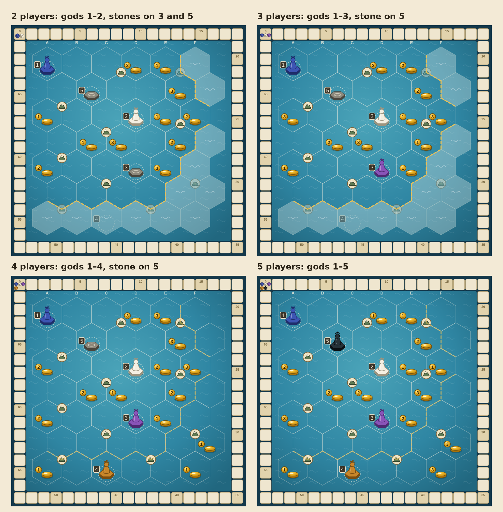

# Day One

A 2–5 player game of raising islands out of an empty sea, by Darren Don (What's Good Board Games).

Each player is an island god. On your turn you pick up a stack of earth, carry it across the sea one space at a time, drop a disc on every space you cross, and raise a shrine where your god comes to rest. Discs you drop on a rival's shrine are offerings: they grow that island, and they score you a point.

**Play it in your browser:** https://darrendon.github.io/day-one/ (or open `index.html` locally). Any seat can be a bot.

## Components

- 1 board: a 6 × 7 hex sea with 10 mountains printed on the corners where three spaces meet, 14 pearl spots and 5 numbered start spaces, plus a dashed line marking the smaller 2–3 player sea. A score track runs around the edge.
- 50 earth discs: 10 each of 5 land types (lava, jungle, sand, coral, basalt).
- 14 pearls worth 1–3.
- Per player: 1 god, 7 shrines, 1 scoring cube and 1 player board with five 0–25 land tracks.
- 2 grey stone shrines.

## Setup

- With 2 or 3 players, play only inside the dashed line.
- Shuffle the pearls onto the pearl spots in play.
- Put 7 / 8 / 10 / 10 discs of each land type in the supply for 2 / 3 / 4 / 5 players.
- Each player takes 7 / 6 / 5 / 4 shrines for 2 / 3 / 4 / 5 players.
- **Start spaces:** pick any player colours. The first player starts on space 1, the second on space 2, and so on. Each player puts one shrine on their start space and stands their god on it.
- **Stone shrines:** put one on every numbered space nobody is using inside the play area. With 2 players that's spaces 3 and 5. With 3 or 4 players it's space 5. With 5 players there are none.

## Your turn

1. **Gather earth.** Top up the stack under your god to 2 discs of one land type from the supply. If the stack already has 2 or more, add 1.
2. **Travel.** Lift the whole stack and move it one space at a time, in any direction, dropping the bottom disc on each space you enter.
   - You can't enter the same space twice in a turn. Mountains sit on corners, so they never block the way.
   - Your god lands last, on a space with no shrine.
3. **Offerings.** A disc you drop on a rival's shrine stays on top of it. They move that land type's marker up 1, and you move your cube up 1 on the score track. A disc you drop on a stone shrine is also an offering: you score 1 and nobody's track moves.
4. **Eruption (once per turn).** If your god lands on an unclaimed stack of 2 or more that contains your land type, the island erupts. Collect its top disc, add 1 disc of your land type, and travel again.
5. **Raise a shrine.** Collect the top disc where your god lands, then slip a shrine under your god. If all your shrines are already out, move one of them here instead.
6. **Seal mountains.** Each mountain touches exactly 3 spaces. The moment all 3 hold shrines, the mountain is sealed: whoever has the most shrines there takes it for 3 points. If players tie, nobody takes it. Once a mountain is sealed, the shrines around it are free to move on to the next one.

**Collecting.** Each earth disc you collect moves that land type's marker up 1 on your player board, to a maximum of 25. The disc then goes back to the supply. Pearls you keep.

## Game end and scoring

The game ends the moment a player can't gather earth because the supply has run dry. Then score:

- **Land types:** for each land type, the furthest along that track scores 10 and a clear second scores 5. If players tie for the most, each of them scores 5.
- **Mountains:** 3 for each mountain you sealed and took. A mountain still open at the end goes to the player with the most shrines around it (a tie scores nothing).
- **Pearls:** their printed value.
- **Offerings:** 1 point per offering you made.
- **Tiebreak:** most discs collected.
